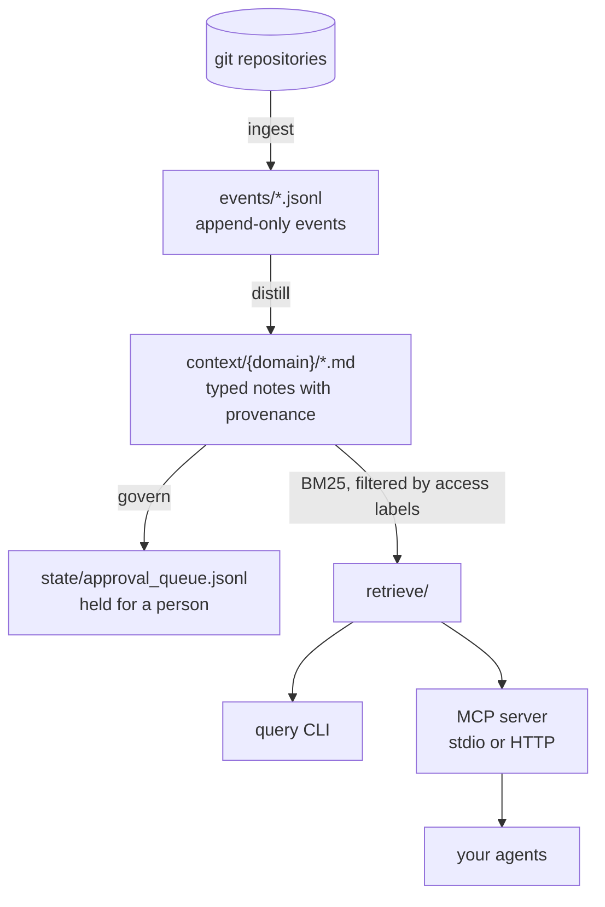

# Remembrancer

Give your team's AI agents a searchable record of what changed and why. Remembrancer turns Git commits into local notes with source citations and serves them over [MCP](https://modelcontextprotocol.io). Each agent sees the notes its identity can read.

> [!NOTE]
> [**v0.1.0-alpha**](https://github.com/scamai/remembrancer/releases/tag/v0.1.0-alpha) ingests Git and stores memory as local files. The quick start and Docker path are tested on Linux with Python 3.12. [See alpha limits](#limits-of-v01).

[Try the demo](#quick-start) · [Use Docker](#docker-demo) · [Index your Git repositories](#your-own-repositories) · [Connect an agent](#connect-an-agent) · [Get help](#get-help)

## Quick start

The demo creates ten fictional commits for Acme. Ask who is on call for `ledger-service` and the CLI returns the answer with its source commit. This excerpt is from a real demo run.

<!-- first-run:output -->
```text
docs: Sam Rivera becomes on-call owner for ledger-service
acl:['eng']
provenance:['git:747d6c350a51c9942b3d807f9af8ae5c8681461d']
[context/eng/docs-sam-rivera-becomes.md]
```

### Run the demo with Python

You need Git, Bash and Python 3.12 or newer. The demo uses the Python standard library. Once cloned, you can run it offline, without installing packages or model weights.

<!-- first-run:install -->
```sh
git clone https://github.com/scamai/remembrancer
cd remembrancer
```

In that fresh checkout, build the fixture, index it and run a query as `dana`, an engineer.

<!-- first-run:run -->
```sh
examples/demo-repo.sh
test -e config.json || cp config.example.json config.json
REMEMBRANCER_LLM_API_KEY= python3 scripts/run.py --ingest-git demo-repo --lint
python3 retrieve/query.py --as dana --q "who is on call for ledger-service"
```

The on-call note ranks first. Open `context/eng/docs-sam-rivera-becomes.md` to see the note and its citations. Ask the same question as `guest`, who has no access labels.

<!-- first-run:guest -->
```sh
python3 retrieve/query.py --as guest --q "who is on call for ledger-service"
```

<!-- first-run:guest-output -->
```text
(no matches)
```

[Connect an agent](#connect-an-agent) when you want this memory in your MCP client. That step installs the server dependencies into a virtual environment.

### Docker demo

If you already have Docker with Compose v2, run this instead of the Python demo from a fresh checkout. Compose builds the image and keeps the sample memory in its named volumes.

```sh
test -e config.json || cp config.example.json config.json
docker compose run --build --rm remembrancer demo
```

Look for the same on-call note. To see the available container commands, run `docker compose run --rm remembrancer help`.

## What just happened

The [demo script](examples/demo-repo.sh) supplies the input. The pipeline writes plain files you can inspect:

1. **Ingest.** Each commit became an event: one JSON line in `events/<day>.jsonl` with its author, date, files and access labels. Git events take their labels from `acl_defaults.git` in `config.json`, `eng` here.
2. **Distill.** Events became typed notes in `context/eng/`: markdown whose frontmatter names its sources. Without an LLM, distill groups each repository's commits by day, one note per day; every demo commit falls on its own day, so each became its own note. The commit message sets the type: `decision:` and `policy:` make decision notes, `eval:` a state note. `context/INDEX.md` lists every note on one line.
3. **Govern.** Decisions wait for a person. The two decisions and the policy are held in `state/approval_queue.jsonl`, so search leaves them out (see [Limits](#limits-of-v01)).
4. **Retrieve.** BM25 ranks the notes the caller may read. `dana` holds `eng`; `guest` holds nothing.

The note behind the answer, abridged:

```text
---
name: docs-sam-rivera-becomes
type: project
domain: eng
acl: [eng]
provenance: [git:747d6c350a51c9942b3d807f9af8ae5c8681461d]
state: proposed
---

docs: Sam Rivera becomes on-call owner for ledger-service

Distilled from:
- `git:747d6c350a51c9942b3d807f9af8ae5c8681461d` (git) docs: Sam Rivera becomes on-call owner for ledger-service
OWNERS.md
```

`state: proposed` marks a note a machine wrote and nobody has verified yet. Search still returns it, ranked below verified notes.

## Your own repositories

Use a separate checkout to keep your memory apart from the demo. Start with [config.example.json](config.example.json), set `identities` and `acl_defaults.git`, then index local Git repositories. Use Bash or another POSIX shell.

```sh
test -e config.json || cp config.example.json config.json
python3 scripts/run.py --ingest-git ~/code/billing ~/code/web --lint
```

- The first run reads each repository's whole history. Later runs add only new commits, so run the same command on a schedule, from cron or a systemd timer, to keep the memory current.
- A repository you add later is distilled in full, including commits older than the notes already there.
- To list repositories in `config.json`, use the `repos` and `monorepos` keys ([AGENTS.md](AGENTS.md)), then run `python3 scripts/run.py --ingest-git --lint` with no path.
- Give each person an identity in `identities`, with the labels they may read. [Who sees what](#who-sees-what) explains the rules.

The pipeline runs on your machine. It reaches the network only when you configure it to. It mirrors repositories specified by URL, by `owner/name` without a local checkout, or through `git_org`. With an LLM key set, distillation sends the commits it processes to the configured endpoint.

## Connect an agent

For a local MCP client, install the server's Python dependencies once. This step downloads Python packages. Use the repository where you ran the demo or indexed your own Git repositories.

<!-- mcp:install -->
```sh
python3 -m venv .venv
. .venv/bin/activate
python -m pip install -r requirements.txt
```

The MCP server speaks stdio by default, and your agent's client starts it. Started by hand, it prints nothing and waits for a client on standard input. It reads as the identity you set in `REMEMBRANCER_IDENTITY`, and a caller cannot claim another: `identity.trust_caller_claims` is `false` in the example config.

For Claude Code, from the repository folder, register the server using the virtual environment you just created.

```sh
claude mcp add remembrancer -e REMEMBRANCER_IDENTITY=dana -- \
  "$PWD/.venv/bin/python" "$PWD/mcp/server.py"
```

Clients that take a JSON file, such as Claude Desktop and Cursor, use this shape. Replace `/path/to/remembrancer` with the repository folder:

<!-- mcp:client -->
```json
{
  "mcpServers": {
    "remembrancer": {
      "command": "/path/to/remembrancer/.venv/bin/python",
      "args": ["/path/to/remembrancer/mcp/server.py"],
      "env": {"REMEMBRANCER_IDENTITY": "dana"}
    }
  }
}
```

<details>
<summary>With Docker</summary>

Use the same checkout and Compose project that hold the indexed memory. The client runs `docker` and passes the identity into the container with `-e`.

<!-- mcp:docker -->
```json
{
  "mcpServers": {
    "remembrancer": {
      "command": "docker",
      "args": ["compose", "-f", "/path/to/remembrancer/compose.yaml", "run", "--rm", "-T",
               "-e", "REMEMBRANCER_IDENTITY=dana", "remembrancer", "mcp"]
    }
  }
}
```

</details>

After connecting, ask your agent to call `remembrancer_whoami`. The demo client should report `dana`. Then ask it to use Remembrancer to find who is on call for `ledger-service`, with a commit citation. For your own repositories, set the client identity to a key in your `config.json`.

The server offers the tools that `mcp.tools` in `config.json` lists. The example config lists all eight:

<!-- mcp:tools -->
- `remembrancer_search` ranks the notes the caller may read for a question.
- `remembrancer_get_note` returns one note in full, with the events behind each claim.
- `remembrancer_timeline` lists one entity's dated history, newest first.
- `remembrancer_recent_git_activity` lists recent commits by author, read from the events, so it does not wait for distillation.
- `remembrancer_dig` searches the raw events when the notes come up short. Its answers are unverified candidates.
- `remembrancer_confirm_answer` queues a `dig` answer the user confirmed, with its citations, to become a note.
- `remembrancer_remember` records a fact a person states, or proposes a correction to a note.
- `remembrancer_whoami` says which identity the session reads as.

## Who sees what

- Every event and note carries access labels (`acl`). A caller reads a note when they hold **any one** of its labels.
- `identities` in `config.json` gives each identity its labels. In the example, `dana` holds `eng` and `guest` holds none.
- A note with no label is public: every caller reads it, an anonymous one too.
- Commit text that looks sensitive, such as pay, legal privilege, immigration or bank details, is labelled `secrets` at ingest, whatever the default. Grant `secrets` only to people who may read that.
- Over stdio the identity comes from `REMEMBRANCER_IDENTITY`; over HTTP your reverse proxy sets it. A caller's own claim is ignored unless `identity.trust_caller_claims` is `true`.
- The query CLI without `--as` runs as the local operator and reads every note. Anyone who can run it can read the files anyway.
- The server records each tool call, with the caller and their question, in `state/mcp_audit.jsonl`. Set `REMEMBRANCER_AUDIT_LOG` to `off` to keep no record, or to a path to keep it elsewhere.

## Serve a team over HTTP

The `http` profile in `compose.yaml` serves MCP over streamable HTTP for a team, behind your own reverse proxy:

```sh
secret=$(python3 -c 'import secrets; print(secrets.token_urlsafe(32))')
echo "REMEMBRANCER_MCP_PROXY_SECRET=$secret" > .env
docker compose --profile http up -d
```

The server listens on `127.0.0.1:8790`, at the path `/remembrancer`. On every request, your proxy must:

1. **Sign the caller in** and set the `Tailscale-User-Login` header to their identity, a key of `identities`, replacing any value the caller sent. Without the header the caller is anonymous and reads only notes with no label.
2. **Send the secret** from `.env` in the `X-Remembrancer-Proxy-Secret` header. Without it the server answers 403.
3. **Send `Host: 127.0.0.1:8790`**, as nginx's `proxy_pass` does by default, or a host listed in `mcp.http.allowed_hosts` in `config.json`. Any other host gets 421.
4. **Drop the `Authorization` header** the caller sent. v0.1 has no token sign-in, so a request that carries one gets 401. nginx passes it on unless you clear it: `proxy_set_header Authorization "";`.

The server is stateless by default, so every request runs with the identity its own headers carry. Stateful mode (`mcp.http.stateless: false` in `config.json`, or `REMEMBRANCER_MCP_STATELESS=0`) runs every call on a session with the identity of the request that opened it, so use it only behind a proxy that serves one person.

Without Docker, `REMEMBRANCER_MCP_TRANSPORT=http python mcp/server.py` serves the same way, with the secret in the environment. [SECURITY.md](SECURITY.md) says what v0.1 protects and what it leaves to you.

## How it works



- **Ingest**, `ingest/`: one connector per source turns its records into events of one shape. An event's id is its dedup key, so a re-run adds nothing twice.
- **Distill**, `distill/` and `govern.py`: clusters events into typed notes. Each cluster gets one action: create, update, link, supersede or ignore. Replaying the same events changes nothing.
- **Lint**, `lint/`: finds orphan notes, links to missing notes, superseded notes and contradictions, and writes `context/_lint_report.md`.
- **Retrieve**, `retrieve/`: reads the index first, then ranks notes with BM25, filtered by the caller's labels.
- **Serve**, `mcp/server.py`: the MCP server, over stdio or streamable HTTP.

`remembrancerlib/` is the shared core: events, notes, cursors and access checks. [AGENTS.md](AGENTS.md) is the operating spec for agents and contributors; the distiller reads its `conventions` block at run time. `scripts/run.py` runs ingest, distill, lint and index in order, and `make help` lists the same steps one by one.

**An LLM is optional.** With one, distill can also judge which events belong together and draft the notes. Set `REMEMBRANCER_LLM_API_KEY` and `REMEMBRANCER_LLM_MODEL` for any Anthropic-compatible endpoint, plus `REMEMBRANCER_LLM_BASE_URL` when it is not Anthropic's own. The other settings, from the timeout to the fan-out, are `REMEMBRANCER_LLM_*` variables listed in `distill/llm_env.py`.

## Limits of v0.1

- **Git is the only source.** The event contracts for other sources ship; their connectors do not.
- **Held notes have no approve command.** Decisions and the other notes `govern.py` holds wait in `state/approval_queue.jsonl`, out of search, and v0.1 has no command or MCP tool to approve them. To admit them as `proposed` instead, set `governance.admission_mode` to `automatic` in `config.json`.
- **Machine-written notes start `proposed`.** The example config turns off the gate that hides unverified notes (`trust.hide_verification_failures: false`); without a `config.json`, search shows no machine-written note at all. [AGENTS.md](AGENTS.md#approval-and-governance) describes verification and approval.
- **Answers are only as good as your commit messages.** Without an LLM, a note holds its commits' subjects and the files they touched, and search ranks those words. Notes distilled from git carry no people or component tags.
- **Tested scale:** flask's whole history, 3,834 commits once merges are skipped, became 1,588 notes in one run of 146 s with 100 MB peak memory, on a 16-core AMD Ryzen 9 7950X shared with other work. A query then took 0.3 s. Measured 2026-11-11 at flask `49943b5a`.
- **Memory is plain files** in `events/`, `context/`, `state/` and `registry/`, next to the code, and one pipeline runs at a time. v0.2 moves storage to a database: SQLite by default, Postgres for a team.

## Get help

- **The demo returns no matches for `dana`.** Run from the repository root. Check that `config.json` exists, that `dana` has `eng`, and that `context/INDEX.md` was created. The sample config allows proposed notes to appear in queries.
- **`demo-repo` already exists.** If the fixture finished, reuse it and run the remaining commands. Ingest skips commits it has already seen. If fixture creation stopped partway through, start in a fresh checkout.
- **The client cannot start the MCP server.** Check the absolute paths to `.venv/bin/python` and `mcp/server.py` and install the dependencies in that same environment. Then reconnect and call `remembrancer_whoami`.

Ask setup questions in [GitHub issues](https://github.com/scamai/remembrancer/issues). Use the [issue forms](https://github.com/scamai/remembrancer/issues/new/choose) for a reproducible bug or a feature proposal. Report vulnerabilities through [GitHub private reporting](https://github.com/scamai/remembrancer/security/advisories/new). [SECURITY.md](SECURITY.md) describes the information to include.

## Contributing

[CONTRIBUTING.md](CONTRIBUTING.md) covers local tests, pull requests and the DCO sign-off. If a first-run step is unclear, reproduce it with the fictional demo and submit the precise command or wording fix. Include the output you used to check it.

## Licence

Apache License 2.0. See [LICENSE](LICENSE) and [NOTICE](NOTICE).
